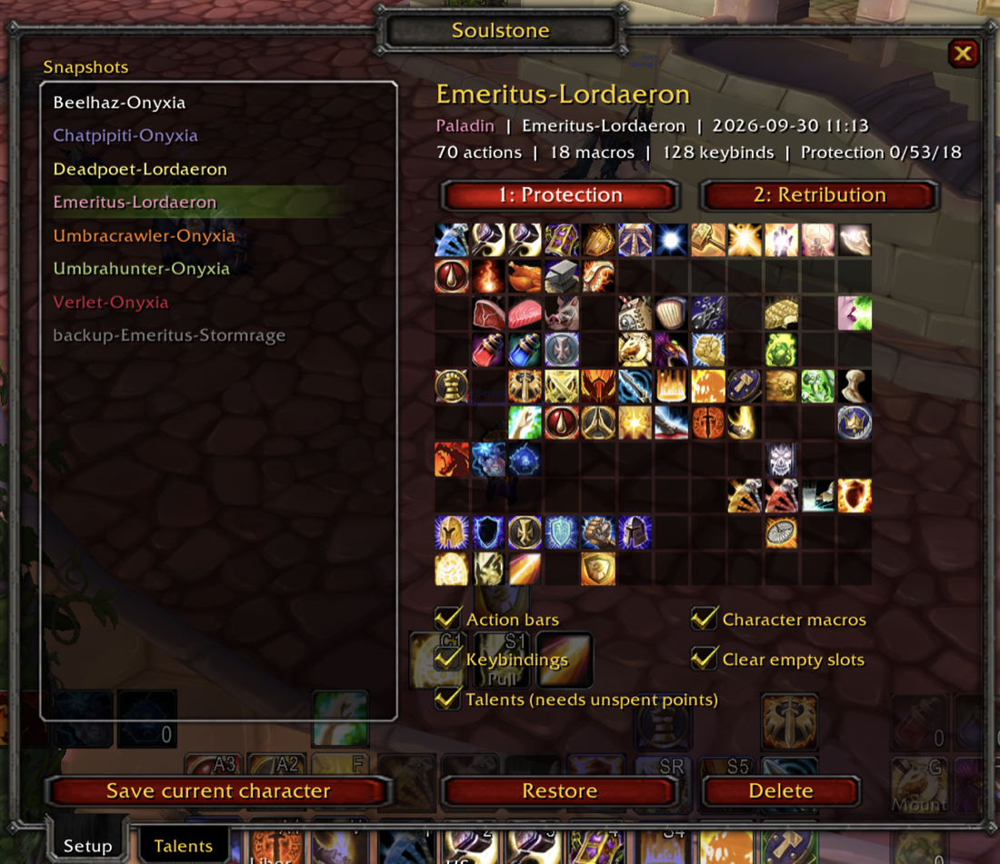
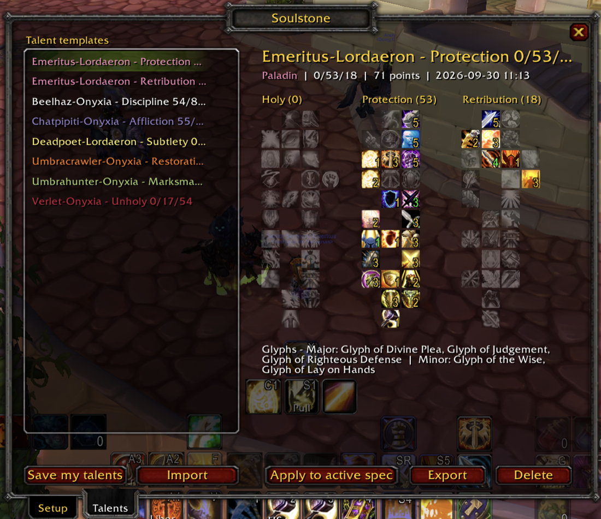

<div align="center">

# 🔮 Soulstone

**Your setup, reborn anywhere.**

Move your action bars, macros, keybindings and talents to another character, realm or server — in a couple of clicks.

-8a2be2)


</div>

---

Changing servers, switching realms or rolling an alt of the same class is exciting. Rebuilding every action bar, retyping every macro, rebinding every key and clicking your talents one by one… is not.

Like a warlock's soulstone, **Soulstone** lets your setup come back to life somewhere else, exactly as you left it.

<p align="center">
  
  
</p>
<p align="center"><sub><b>Setup</b> — every snapshot with a preview of its bars, per spec &nbsp;·&nbsp; <b>Talents</b> — templates with their trees and glyphs</sub></p>

## ✨ What it moves

| | What | How |
|---|---|---|
| 🎯 | **Action bars** — all 120 slots, **both specs** | Restored automatically. Spells, items, macros, mounts, pets and equipment sets |
| 📜 | **Character macros** | Recreated on the new character. Existing macros with the same name are never touched |
| ⌨️ | **Keybindings** | Applied as character bindings, including **Bartender4** button bindings |
| 🌳 | **Talents** — both specs | Applied automatically using your unspent talent points |
| 💎 | **Glyphs** | Shown as a checklist (the game doesn't let addons use glyph items) |

Plus:

- 🗂️ **Talent templates** — save builds, design them with Blizzard's talent preview, or import them from **Wowhead**. Apply them in one click, even partially while leveling.
- 👀 **Visual preview** of every snapshot: all 120 slots with tooltips, and the talent trees of every template.
- 🛟 **Automatic backup** before every restore — undo with one click.
- 🔁 **Dual spec aware** — Soulstone switches spec for you to save or restore the other spec's bars, and copies one spec's bars onto the other so a new spec doesn't start from zero.
- 🌍 English and Spanish (`esES` / `esMX`) localization.

## 🚀 Quick start: moving to a new server

> Soulstone keeps its snapshots in your **account-wide** SavedVariables, so every character that uses the same `WTF/Account/<ACCOUNT>` folder can see them — even on a different server.

1. **On your old character**, open Soulstone (minimap button or `/soulstone`) and click **Save current character**.
   If you have dual spec, accept the prompt to also save your other spec.
2. Type **`/reload`** or log out. *The game only writes addon data to disk at this moment.*
3. **On your new character**, open Soulstone, pick the snapshot and click **Restore**.
   With dual spec, accept the prompt to restore the other spec too.
4. Log out normally so the server stores your new setup.

That's it. Anything that couldn't be placed — a spell your new character doesn't know yet, an item that isn't in your bags — is listed in the chat.

> **Different account name on the new server?** Copy `WTF/Account/<OLD>/SavedVariables/Soulstone.lua` into `WTF/Account/<NEW>/SavedVariables/` before logging in.

## 🔁 Dual spec

Talents and glyphs of **both** specs are saved every time. Action bars are trickier: the game client only knows the bars of your **active** spec — the other spec's bars live on the server.

So Soulstone does the boring part for you:

1. switches to your other spec (the normal 5-second cast — don't move),
2. waits for the server to send that spec's bars,
3. saves (or restores) them,
4. asks whether you want to switch back.

When restoring, bars from any saved spec can go to any spec: pick **1** or **2** in the snapshot view and they are applied to your **active** spec.

### Copy one spec's bars onto the other

Just bought dual spec and your second spec is a blank set of bars? Soulstone notices and offers to **copy the bars of your other spec as a starting point** — then you only change what is different.

- Soulstone **remembers each spec's bars by itself** while you play, so nothing has to be saved first.
- **Only empty slots** (default): what you already placed in this spec stays where it is. Untick *Copy spec: only empty slots* to make both specs identical.
- Spells this spec doesn't know (usually talent spells) are skipped and listed in the chat.
- A backup is saved before copying, as with every restore.

To paste the bars of the spec you are in onto the other one, use **Copy spec N to spec M** in the Setup tab (or `/soulstone copyto`): Soulstone switches spec (the normal 5-second cast), pastes them there and offers to switch back. `/soulstone copy` does the opposite, from the other spec onto this one, without switching.

## 🌳 Talent templates

Open the **Talents** tab to manage your builds.

**Create a template** in any of these ways:

- **Save my talents** — saves your active spec.
- **Design it in-game** — in Blizzard's talent window, spend points in *preview mode* (don't click *Learn*), then click **Save my talents**. The preview is what gets saved.
- **Import** — paste a Wowhead WotLK talent calculator link:
  ```
  https://www.wowhead.com/wotlk/talent-calc/paladin/-05503201-05232051203331302133231331
  ```
- **Automatically** — every snapshot you save also creates a template for each of its specs.

**Apply a template** with **Apply to active spec**. Soulstone spends your unspent points following the build — main tree first, top to bottom — so every step is valid. Not enough points yet? It applies what it can and tells you how many are missing; just apply it again after leveling.

**Share it** with **Export**, which gives you the Wowhead link.

> Soulstone never resets talents (that costs gold and needs a trainer). If your spec already has points outside the build, it tells you which ones and doesn't change anything.

## 📦 Installation

**Recommended:** download `Soulstone.zip` from the [latest release](https://github.com/pabhoz/Soulstone-WoW-Addon/releases/latest) and extract it into:

```
World of Warcraft/Interface/AddOns/
```

You should end up with `Interface/AddOns/Soulstone/Soulstone.toc`.

<details>
<summary>Other ways to install</summary>

**With git:**

```sh
cd "World of Warcraft/Interface/AddOns"
git clone https://github.com/pabhoz/Soulstone-WoW-Addon.git Soulstone
```

**With GitHub's "Download ZIP" button:** extract it and **rename** the folder from `Soulstone-WoW-Addon-main` to `Soulstone` — WoW only loads an addon when its folder name matches the `.toc` file.

</details>

Then make sure **Soulstone** is enabled in the **AddOns** list on the character select screen.

## ⌨️ Slash commands

`/soulstone` (or `/sstone`) opens the window. Everything is also available from the chat:

| Command | What it does |
|---|---|
| `/soulstone` | Open / close the window |
| `/soulstone save [name]` | Save a snapshot (default name: `Character-Realm`) |
| `/soulstone saveboth [name]` | Save, switch spec, save the other spec's bars too |
| `/soulstone load <name> [1\|2]` | Restore a snapshot on this character (optionally from saved spec 1 or 2) |
| `/soulstone loadboth <name>` | Restore both specs (switches spec) |
| `/soulstone copyto [fill\|all]` | Copy your active spec's bars onto the other spec (switches spec) |
| `/soulstone copy [fill\|all]` | Copy the other spec's bars onto your active spec (only empty slots, or everything) |
| `/soulstone list` | List snapshots |
| `/soulstone delete <name>` | Delete a snapshot |
| `/soulstone minimap` | Show / hide the minimap button |

## 💡 Good to know

<details>
<summary><b>How do I undo a restore?</b></summary>

Before every restore, Soulstone saves your character's current setup as `backup-<Character>-<Realm>`. When you restore both specs, the backup keeps the original bars of both. Restore that snapshot to go back.
</details>

<details>
<summary><b>Will it overwrite my existing macros?</b></summary>

No. Character macros are only created when no macro with that name exists. **Account-wide (general) macros are never created or modified** — if a bar slot used a general macro that doesn't exist on the new server, it is reported in the chat.
</details>

<details>
<summary><b>What happens to my keybindings?</b></summary>

When *Keybindings* is checked, the character's bindings are **replaced** with the snapshot's, saved as character-specific bindings. Uncheck it in the Setup tab if you only want bars and macros.
</details>

<details>
<summary><b>Does it touch my WTF files?</b></summary>

No. Everything happens in-game through the regular WoW API, and the server stores the result like any change you'd make by hand. Soulstone only writes its own SavedVariables file.
</details>

<details>
<summary><b>What about my bar layout (position, size, paging)?</b></summary>

That belongs to your bar addon (Bartender4, Dominos…). Use its profiles — they're account-wide too, so a new character can simply pick the same profile.
</details>

<details>
<summary><b>Anything it can't do?</b></summary>

- **Glyphs** can't be applied by addons — Soulstone lists them so you know what to buy.
- **Pet bars and stance/possess bars** aren't included.
- Spells are matched by name and rank; if the exact rank isn't known yet, the highest known rank is used.
</details>

## 🌍 Translations

Soulstone ships in **English** and **Spanish**. Want it in your language? Add a block for your locale in [`Locales.lua`](Locales.lua) and open a pull request — every string in the addon is there.

## 🤝 Contributing

Bug reports, ideas and pull requests are welcome in [Issues](https://github.com/pabhoz/Soulstone-WoW-Addon/issues). When reporting a bug, please include:

- the server / client you play on,
- what you clicked or typed,
- any Lua error text (tip: `/console scriptErrors 1` shows them).

## 📄 License

Soulstone is free software: you can redistribute it and/or modify it under the terms of the **GNU General Public License v3.0** (or any later version). See [LICENSE](LICENSE) for the full text.

<div align="center">

Made with 💜 by [pabhoz](https://github.com/pabhoz) for everyone who's tired of rebuilding their bars.

</div>
